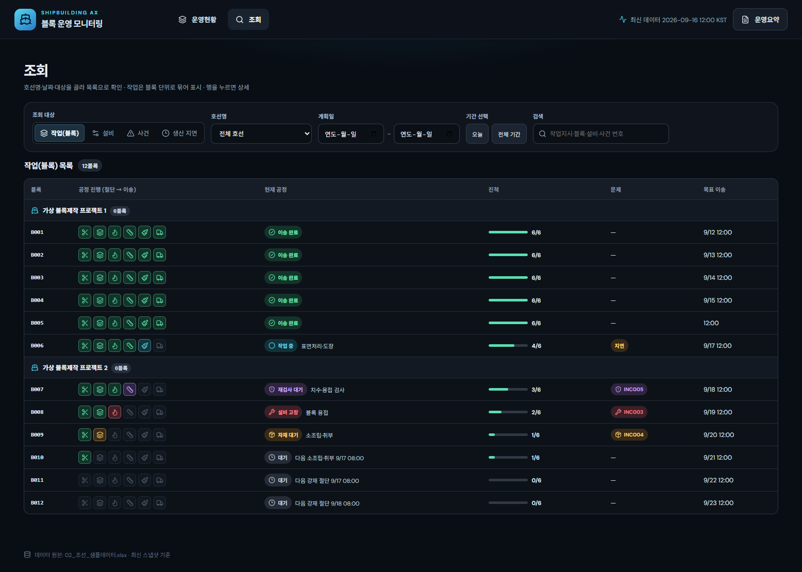

# 조선 AX 블록 운영 모니터링

조선 블록의 작업지시, 생산 실적, 설비 상태, 사건 이력을 한 화면에서 확인하는 웹 샘플입니다. 현재 데이터는 제공된 합성 엑셀 파일을 사용합니다.

## 프로젝트 구조

```text
app/
  frontend/       React + Vite 화면
  backend/        ASP.NET Core API, 엑셀 데이터 로더
엑셀 파일/         샘플 데이터와 항목 명세
work/            기존 HTML 화면과 생성 스크립트
outputs/         생성된 HTML과 화면 샘플
```

프론트엔드와 백엔드는 **한 저장소 안의 별도 폴더**로 관리합니다.

## 실행 방법

필요 환경: .NET SDK 10, Node.js, pnpm.

프로젝트 루트에서 두 터미널을 열어 실행합니다.

```powershell
dotnet restore app/backend/AxBackend.csproj
dotnet run --project app/backend/AxBackend.csproj --urls http://127.0.0.1:5181
```

```powershell
cd app/frontend
pnpm install
pnpm dev --host 127.0.0.1
```

브라우저에서 `http://127.0.0.1:5173/`을 엽니다. Vite가 `/api` 요청을 C# 서버로 전달합니다.

## 데이터와 API

C# 서버는 `엑셀 파일/02_조선_샘플데이터.xlsx`의 15개 시트를 읽습니다. 원본 파일의 수정 시각이 바뀌면 데이터를 다시 읽습니다.

| 경로 | 용도 |
| --- | --- |
| `GET /api/health` | 데이터 원본, 최신 스냅샷 시각, 시트별 건수 확인 |
| `GET /api/data` | 15개 시트의 원본 행을 JSON으로 제공 |

React 화면은 최신 `equipment_snapshot.as_of` 시각까지의 이력으로 현황을 계산합니다. 샘플 데이터 기준 금일 계획 중 완료 2/6건, 기한 도래 미완료 4건, 미해소 사건 3건, 고장설비 1/8대입니다.

## 화면 범위

- 운영현황: 네 가지 핵심 지표, 공정 배치도, 주목할 작업
- 조회: 호선별 블록과 6공정 상태, 설비, 사건, 생산 지연 목록 및 기간·검색 필터
- 상세: 블록의 6공정 작업, 작업 계획·실적·이력·사건, 설비 상태 구간
- 운영요약: 규칙 기반 관측 사실과 확인 요청을 수정·복사 가능



**AI 요약 영역은 비어 있습니다.** 외부 AI API, 모델, API 키는 연결하지 않았습니다. 기존 HTML 화면의 규칙 기반 운영요약도 유지됩니다.

React 버전은 현재 화면 샘플입니다. 기존 HTML의 CSV 업로드 데모, 과거 시각 재생, 블록 상세 전체 항목은 아직 이식하지 않았습니다. 운영 DB나 MES/PLC와도 연결되지 않았습니다.

기존 HTML 화면은 `python work/build_screen.py`로 다시 생성할 수 있으며 결과는 `outputs/조선_AX_이력탐색_화면.html`입니다.
