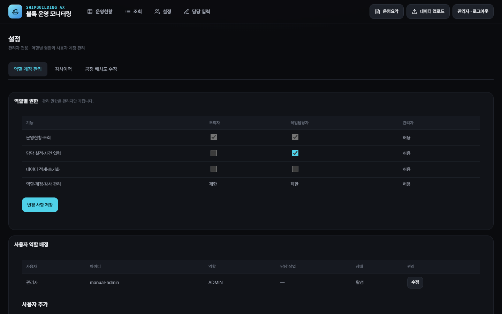
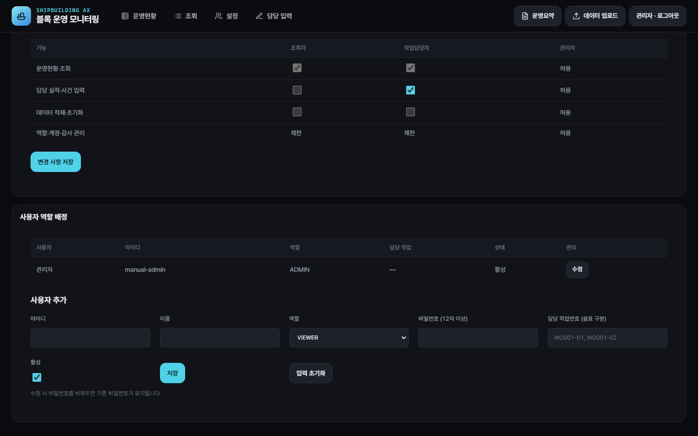
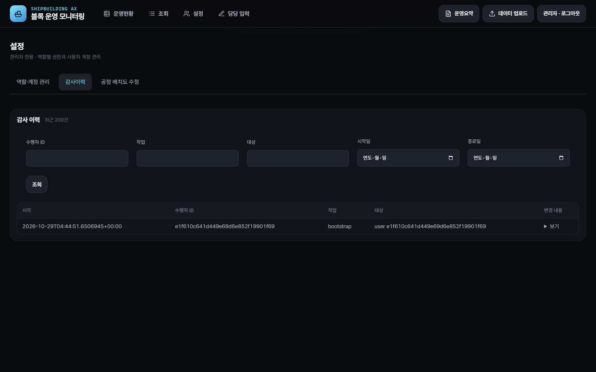
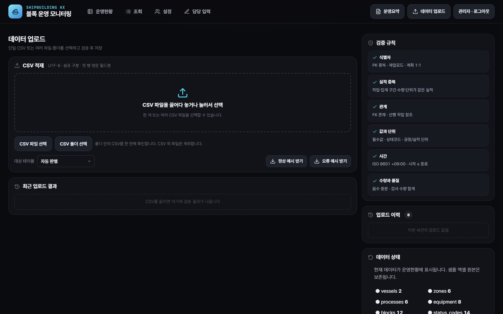
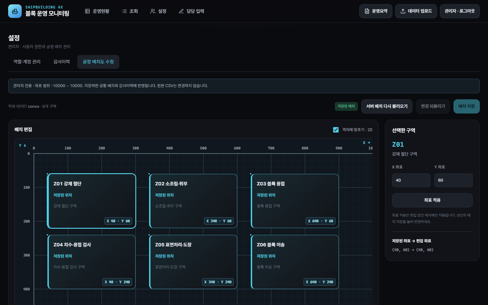

# 조선 AX 관리자 화면별 상세 매뉴얼

2026-10-29 현재 제품 코드 기준이다. 화면 사진은 **별도 상태 파일을 사용한 격리된 샘플 실행**에서 촬영했다. 사진 속 사용자명과 데이터 건수는 예시이며 실제 운영 상태를 뜻하지 않는다. 관리자 화면의 항목명은 `app/frontend/index.html`, 저장·권한 규칙은 `app/backend/Program.cs`와 관련 기능 문서에 대조했다.

## 1. 로그인 후 관리자 메뉴

관리자(`ADMIN`)로 로그인하면 상단에서 **운영현황, 조회, 설정, 담당 입력, 운영요약, 데이터 업로드**를 이용할 수 있다. 이 문서는 관리자가 변경을 수행하는 **설정, 담당 입력, 데이터 업로드** 화면을 자세히 다룬다. 조회와 운영요약의 수치 해석은 [기능 명세](기능.md)와 [운영요약 알고리즘 보고](운영요약_알고리즘_코드_보고_2026-10-28.md)를 따른다.

최초 관리자 계정이 없는 로컬 환경에서는 백엔드 실행 터미널의 `AX_ADMIN_LOGIN`, `AX_ADMIN_PASSWORD`로 한 번 생성한다. 비밀번호는 12자 이상이어야 한다. 기존 계정이 있으면 이 환경변수로 기존 계정이 바뀌지 않는다. 계정 설정의 실행 절차와 저장 위치는 [로그인·권한·감사](로그인_권한_감사.md)에 있다.

## 2. 설정 → 역할·계정 관리

설정에는 **역할·계정 관리**, **감사이력**, **공정 배치도 수정** 탭이 있다. 역할·계정 관리에는 위쪽 **역할별 권한**, 아래쪽 **사용자 역할 배정**이 나타난다.

### 2.1 역할별 권한 표

| 행 | 조회자 `VIEWER` | 작업담당자 `WORKER` | 관리자 `ADMIN` |
| --- | --- | --- | --- |
| 운영현황·조회 | 고정 허용. 체크박스 비활성 | 고정 허용. 체크박스 비활성 | 허용 |
| 담당 실적·사건 입력 | 체크로 허용·해제 | 기본 허용, 체크로 해제 가능 | 허용 |
| 데이터 적재·초기화 | 체크로 허용·해제 | 체크로 허용·해제 | 허용 |
| 역할·계정·감사 관리 | 제한 | 제한 | 허용 |

**변경 절차:** 원하는 `VIEWER`·`WORKER` 체크박스를 바꾸고 **변경 사항 저장**을 누른다. 화면의 저장 메시지를 확인한다. 조회 권한과 관리자 권한은 이 표에서 다른 역할로 옮길 수 없다. 서버는 저장 요청의 역할 이름과 권한 종류를 다시 검사하고 변경을 감사 이력에 남긴다. 화면을 다시 열어 체크 상태가 저장한 값인지 확인한다.

기존 로그인 세션의 화면 메뉴는 페이지를 새로 읽을 때 새 권한 표시가 반영될 수 있다. 서버는 요청마다 현재 계정·역할·권한을 확인하므로, 권한 변경 직후 화면에 버튼이 남아 보여도 저장 요청은 서버 권한을 따른다.

### 2.2 사용자 목록과 추가 양식

목록에는 **사용자명, 아이디, 역할, 담당 작업, 활성 상태, 수정 버튼**이 표시된다. 새 계정을 만들 때 아래 양식을 사용한다.

| 입력 항목 | 넣을 값 | 저장 시 검사 |
| --- | --- | --- |
| 아이디 | 로그인에 쓸 고유 문자열 | 필수. 기존 아이디와 대소문자 구분 없이 중복이면 거부 |
| 이름 | 화면에 표시할 사용자명 | 필수 |
| 역할 | `VIEWER`, `WORKER`, `ADMIN` 중 선택 | 세 역할 이외 값 거부 |
| 비밀번호 | 새 계정의 비밀번호 | 신규 계정은 12자 이상 필수 |
| 담당 작업번호 | `WO001-01, WO001-02`처럼 쉼표로 구분 | 빈 값 허용. 적은 번호가 현재 작업지시에 없으면 거부 |
| 활성 | 로그인·사용 여부 | 체크 상태로 저장 |

**신규 계정:** 값을 입력하고 **저장**을 누른다. 성공하면 목록을 다시 불러오므로 새 사용자가 나타나는지 확인한다. **입력 초기화**는 작성 중인 양식을 비우고 신규 추가 모드로 돌아간다. 저장된 계정을 삭제하거나 기존 계정 값을 되돌리는 기능은 아니다.

**기존 계정 수정:** 목록의 **수정**을 누르면 아래 양식이 *사용자 수정* 모드로 바뀌며 값이 채워진다. 아이디는 수정할 수 없고, 비밀번호를 비우면 기존 비밀번호를 유지한다. 이름·역할·담당 작업·활성 상태를 바꾼 뒤 저장한다. 역할, 활성 상태 또는 비밀번호가 바뀌면 해당 사용자의 기존 세션이 무효화된다. 마지막 활성 관리자 계정은 다른 역할로 바꾸거나 비활성화할 수 없다.

**담당 작업의 의미:** 작업담당자는 배정된 작업의 실적·사건만 등록·수정할 수 있다. 관리자 계정은 담당 작업 목록과 관계없이 작업 입력이 가능하다. 다른 사용자에게 작업을 배정할 때는 목록의 작업번호가 실제 데이터에 있는지 먼저 확인한다. 데이터를 초기화해 작업지시가 사라지면 기존 배정의 활용 가능성도 달라진다.

## 3. 설정 → 감사이력

| 화면 항목 | 사용 방법 |
| --- | --- |
| 수행자 ID | 작업을 실행한 계정의 ID 일부를 입력해 좁힌다. 화면의 로그인 아이디와 별개로 감사 기록의 수행자 ID를 기준으로 검색한다. |
| 작업 | `create`, `update`, `permissions`, `reset`, `restore-sample`, `layout:update` 등 감사 작업명의 일부를 입력한다. |
| 대상 | `user`, `roles`, `zones` 등 대상 종류 또는 대상 ID의 일부를 입력한다. |
| 시작일·종료일 | 한국시간 날짜 범위를 입력한다. 시작일이 종료일보다 늦으면 화면에서 조회를 막는다. |
| 조회 | 조건을 적용해 최신 기록부터 최대 200건을 표시한다. |
| 변경 내용 → 보기 | 해당 행의 `before`·`after` 값을 펼쳐 저장 전후를 비교한다. |

계정 생성·수정, 역할 권한 변경, 데이터 업로드·초기화·복원, 담당 입력, 좌표 변경은 성공 저장 시 감사 기록이 남는다. **실패 또는 권한 거부 요청은 현재 감사 이력에 남지 않는다.** 비밀번호와 쿠키 값도 감사 기록에 넣지 않는다. 감사 화면의 시각과 변경 내용을 함께 확인해 어떤 저장이 반영됐는지 판단한다.

## 4. 데이터 업로드 → CSV 적재

### 4.1 파일 선택 영역의 기능

| 컨트롤 | 기능과 결과 |
| --- | --- |
| 끌어다 놓기 영역 | CSV 하나 또는 여러 개를 선택한다. |
| CSV 파일 선택 | 파일 선택 창에서 단일 또는 여러 CSV를 고른다. 한 파일이면 표 미리보기, 여러 파일이면 파일 목록 화면으로 간다. |
| CSV 폴더 선택 | 폴더의 하위 폴더까지 CSV를 고른다. CSV가 아닌 파일은 제외하고 제외 개수를 표시한다. 브라우저의 폴더 선택 지원이 필요하다. |
| 대상 테이블 | 단일 파일의 대상 테이블을 자동 판별하거나 직접 고른다. 파일 헤더와 서버 명세가 맞는지 저장 때 확인한다. |
| 정상·오류 예시 받기 | 데이터가 준비된 경우 예시 CSV를 내려받는다. 데이터가 비어 있으면 선택 테이블 양식을 받을 수 있다. |

CSV는 **UTF-8, 쉼표 구분, 첫 줄 영문 필드명** 형식이다. 원본 요구사항 엑셀이나 샘플 엑셀 파일을 이 화면에서 덮어쓰지 않는다. 적재 결과는 로컬 서버 상태 파일에 저장된다.

### 4.2 단일 CSV: 표에서 수정 후 저장

1. CSV 파일 하나를 선택한다. 화면이 대상 테이블과 행을 판별해 **CSV 미리보기 · 셀 검증** 표를 보여 준다.
2. 빨간 셀은 오류이며 셀 제목과 아래 오류 목록에서 이유를 확인한다. 정상 셀은 초록색으로 표시된다.
3. 표의 값을 직접 수정하거나 **열 추가**, **행 추가**, 행 삭제를 사용한다. 수정할 때마다 화면의 검증 결과가 갱신된다.
4. 오류가 0건이면 **검증 후 업로드** 버튼이 활성화된다. 누르면 서버가 다시 검사한 뒤 저장한다.
5. 성공 시 **적재 완료** 결과와 테이블·행 수를 확인하고 화면 집계가 갱신됐는지 본다. 서버 오류가 남으면 저장되지 않는다.

### 4.3 여러 CSV·폴더: 전체 검증 후 저장

1. 파일 목록의 **파일명·대상 테이블·행 수**를 확인한다. 폴더 모드에서는 셀을 화면에서 수정할 수 없으므로 원본 CSV를 수정해 다시 선택한다.
2. **서버 검증**을 누른다. 서버는 파일 선택 순서와 상관없이 참조 관계에 맞는 순서로 검사한다.
3. 오류가 있으면 파일·행·필드·규칙·메시지를 확인한다. 화면은 최대 50건과 나머지 개수를 표시한다. **하나라도 오류가 있으면 전체 업로드를 사용할 수 없다.**
4. 서버 검증 통과 후 **전체 업로드**를 누른다. 저장 요청에서 다시 검증하고 전체 파일을 한 번에 저장한다. 일부 파일만 성공으로 남지 않는다.

### 4.4 검증 규칙과 중복 판정

화면의 검증 규칙은 **식별자, 실적 중복, 관계, 값과 단위, 시간, 수량과 품질**로 나뉜다. 서버는 기본키 중복, 필수값·자료형, 참조키, 상태·단위, 시각 순서, 음수 실적 등을 확인한다. 생산계획은 작업지시당 한 건이다. 생산실적은 **실적번호가 달라도 작업지시·집계 시작·종료·신규 인정수량·단위가 같으면 중복**으로 거부한다. 상세 기준은 [CSV 폴더 업로드와 중복 검증](CSV_폴더업로드_및_중복검증.md)을 참고한다.

## 5. 데이터 업로드 → 데이터 상태·초기화·복원

업로드 화면의 **데이터 상태**에는 테이블별 행 수와 화면 준비 여부가 표시된다. **최근 업로드 결과**와 **업로드 이력**은 현재 브라우저 세션의 업로드 확인에 사용하고, 장기 변경 근거는 관리자 **감사이력**에서 확인한다.

| 버튼 | 확인 창 | 서버와 화면에 미치는 영향 |
| --- | --- | --- |
| 데이터 초기화 | 현재 데이터를 비울지 확인 | 15개 업무 테이블의 표시 데이터를 비운다. 새로고침 후 운영현황은 0/0과 미작업으로 표시된다. 감사에는 `reset`이 남는다. |
| 샘플 데이터 복원 | 현재 적재 데이터를 샘플로 교체할지 확인 | 현재 서버 데이터를 샘플 엑셀 내용으로 교체한다. 파일이 없으면 실패한다. 새로고침 후 샘플 수치가 표시되고 감사에는 `restore-sample`이 남는다. |

두 버튼은 **현재 적재 데이터 전체**에 영향을 준다. 특정 CSV만 취소하는 기능은 아니다. 원본 샘플 엑셀은 두 작업으로 수정되지 않는다. 작업 전후에 데이터 상태의 테이블별 건수와 감사 이력을 확인한다.

## 6. 설정 → 공정 배치도 수정

### 6.1 선택과 위치 변경

화면 위쪽에는 **적재 데이터 `zones`의 구역 수**, **저장 전 변경 건수**, **서버 배치 다시 불러오기**, **변경 되돌리기**, **배치 저장**이 있다. 가운데 **배치 편집** 영역에서 구역을 선택하면 오른쪽 **선택한 구역**에 코드·이름·X/Y가 나타난다.

| 조작 | 편집 중 초안에 주는 영향 |
| --- | --- |
| 구역 드래그 | 구역을 화면에서 옮긴다. ‘격자에 맞추기’가 켜져 있으면 20단위로 맞춘다. |
| 구역 선택 후 방향키 | 격자 켜짐: 20단위, 꺼짐: 1단위 이동. Shift를 누르면 이동 폭이 5배가 된다. |
| X·Y 직접 입력 → 좌표 적용 | `-10000 ~ 10000`의 유한한 숫자를 편집 초안에 반영한다. 이 단계만으로 서버에 저장되지 않는다. |
| 격자에 맞추기 · 20 | 이후 드래그·방향키의 이동 간격을 바꾼다. |

화면의 **저장된 좌표 → 편집 좌표**와 아래 **변경 내역** 표에서 구역별 기존 X/Y와 새 X/Y를 확인한다. 구역을 의도적으로 겹치게 둘 수 있고 자동 겹침 방지는 없다. 좌표는 실제 조선소 도면의 위치가 아니라 개념 배치 값이다.

### 6.2 취소·서버 재조회·저장

- **변경 되돌리기:** 현재 브라우저의 저장 전 변경을 모두 버리고 마지막으로 읽은 저장 좌표로 돌아간다.
- **서버 배치 다시 불러오기:** 서버의 최신 `zones`를 새로 읽고 저장 전 변경을 버린다. 다른 관리자가 먼저 저장한 경우 이 버튼으로 최신 배치를 받아야 한다.
- **배치 저장:** 변경 목록을 서버에 보낸다. 서버는 각 구역의 이전 좌표가 현재 서버 값과 같은지 검사한다. 다르면 **409 충돌로 전체 요청을 거부**한다. 저장 성공 시 현재 브라우저의 운영현황·상세·비교 배치에 반영되고 `layout:update` 감사가 남는다. 다른 브라우저는 새로고침해야 한다.

이 저장은 적재된 서버 데이터의 **구역 X/Y만** 바꾼다. 구역명·공정 관계와 원본 CSV·엑셀은 변경하지 않는다. `zones`가 비어 있으면 선택·저장할 구역이 없다.

## 7. 담당 입력에서 관리자가 확인할 점

관리자는 담당 입력 메뉴에서 생산 실적 또는 사건을 선택하고 새 기록을 입력하거나 기존 기록을 고칠 수 있다. **입력 종류**를 바꾸면 양식 항목이 해당 테이블 명세로 바뀐다. **기존 기록 선택**을 사용하면 선택한 기록의 값이 채워지고, *새 기록*을 선택하면 새 행을 만든다. 저장 성공 메시지는 “새로고침하면 현황에 반영됩니다.”라고 안내한다. 저장 후 화면을 새로고침해 운영현황·조회·운영요약 수치가 의도대로 바뀌었는지 확인한다. 데이터 오류는 필드별 메시지로 표시된다 (`index.html` 1485–1489행).

## 8. 저장 후 점검표

| 수행한 작업 | 화면에서 바로 확인 | 교차 확인 |
| --- | --- | --- |
| 역할 권한 변경 | 저장 메시지와 체크 상태 | 해당 역할의 재로그인 화면 및 권한 거부 여부, 감사 이력 |
| 사용자 추가·수정 | 사용자 목록의 역할·담당 작업·활성 상태 | 대상 사용자의 로그인·배정 작업, 감사 이력 |
| CSV 적재 | 적재 완료·파일·행 수, 데이터 상태 | 운영현황·조회 값, 감사 이력 |
| 데이터 초기화·복원 | 확인 창 후 새로고침, 테이블별 건수 | 운영현황 0/0 또는 샘플 수치, 감사 이력 |
| 배치 좌표 저장 | 저장 전 변경 건수 해소, 저장 메시지 | 메인·비교 배치, 다른 브라우저 새로고침, 감사의 전후 좌표 |

현재 저장 방식은 단일 서버 프로세스의 로컬 상태 파일이다. 운영 DB, 다중 서버 동시 쓰기, 장기 감사 보존·백업 정책은 별도 운영 구성이 필요하다.
